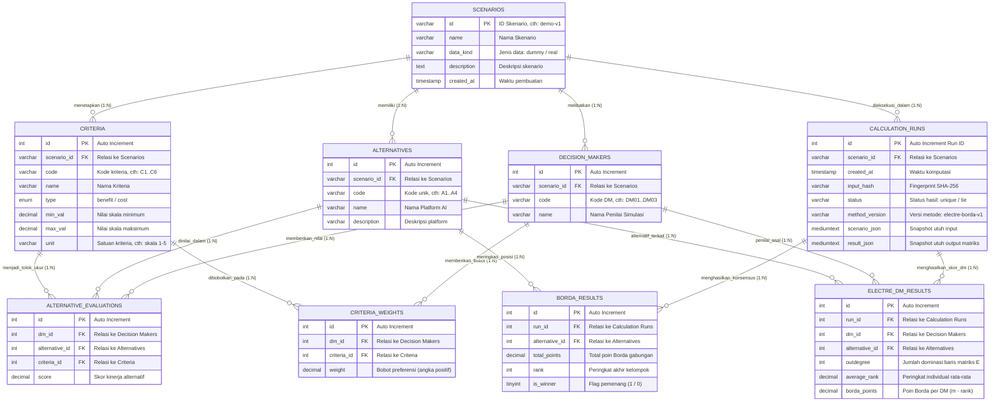

# Perancangan Basis Data: Entity-Relationship Diagram (ERD) & Kamus Data

**Mata Kuliah:** Praktikum Sistem Informasi / GDSS  
**Judul Proyek:** Implementasi GDSS Menggunakan Metode ELECTRE dan Borda dalam Pemilihan Platform Artificial Intelligence untuk Mendukung Produktivitas Akademik Mahasiswa  
**Penanggung Jawab:** Erai Bagusalim (240605110088) — Backend & Database  
**Format Basis Data:** MySQL / MariaDB (Normalisasi Standar 3NF)  
**Berkas Skema Fisik:** `database/gdss_mysql_schema.sql`

---

## 1. Pendahuluan & Model Konseptual

Sistem Pendukung Keputusan Kelompok (*Group Decision Support System* / GDSS) ini dirancang untuk mengakomodasi penilaian multi-kriteria dari banyak penilai (*Decision Makers*) terhadap beberapa alternatif platform AI, lalu mengagregasikan preferensi individu menggunakan metode **ELECTRE I** dan konsensus kelompok **Borda Ordinal**.

Untuk mendukung transparansi komputasi dan manajemen data akademik, basis data dirancang dalam bentuk **relasional murni (Third Normal Form / 3NF)** yang memisahkan entitas master, preferensi penilaian, dan rekam jejak (*audit trail*) hasil komputasi.

---

## 2. Diagram Hubungan Entitas (Entity-Relationship Diagram)

Berikut adalah visualisasi ERD lengkap menggunakan notasi relasional *Crow's Foot*:



---

## 3. Kamus Data (Data Dictionary) Lengkap

### 3.1 Tabel `scenarios` (Master Skenario GDSS)
Tabel ini menyimpan metadata skenario GDSS yang aktif.

| Nama Kolom | Tipe Data | Nullable | Keterangan / Constraint |
|---|---|:---:|---|
| `id` | VARCHAR(40) | NO | **Primary Key**, kode unik skenario (cth: `demo-v1`). |
| `name` | VARCHAR(120) | NO | Nama deskriptif skenario evaluasi. |
| `data_kind` | VARCHAR(20) | NO | Default `'dummy'`, penanda etis simulasi akademik. |
| `description` | TEXT | YES | Catatan latar belakang skenario. |
| `created_at` | TIMESTAMP | NO | Default `CURRENT_TIMESTAMP`. |

---

### 3.2 Tabel `alternatives` (Alternatif Platform AI)
Menyimpan entitas platform AI yang menjadi objek evaluasi mahasiswa.

| Nama Kolom | Tipe Data | Nullable | Keterangan / Constraint |
|---|---|:---:|---|
| `id` | INT | NO | **Primary Key**, Auto Increment. |
| `scenario_id` | VARCHAR(40) | NO | **Foreign Key** $\to$ `scenarios(id)` ON DELETE CASCADE. |
| `code` | VARCHAR(20) | NO | Kode alternatif (cth: `A1`, `A2`, `A3`, `A4`). |
| `name` | VARCHAR(120) | NO | Nama platform AI (cth: `ChatGPT`, `Gemini`, `Claude`, `Perplexity`). |
| `description` | VARCHAR(255) | YES | Karakteristik fungsional platform. |
| *Constraint Unik* | — | — | `UNIQUE KEY (scenario_id, code)` |

---

### 3.3 Tabel `criteria` (Kriteria Penilaian GDSS)
Menyimpan dimensi pengukuran kualitas dan kinerja platform AI.

| Nama Kolom | Tipe Data | Nullable | Keterangan / Constraint |
|---|---|:---:|---|
| `id` | INT | NO | **Primary Key**, Auto Increment. |
| `scenario_id` | VARCHAR(40) | NO | **Foreign Key** $\to$ `scenarios(id)` ON DELETE CASCADE. |
| `code` | VARCHAR(20) | NO | Kode kriteria (cth: `C1` s/d `C6`). |
| `name` | VARCHAR(120) | NO | Label kriteria (cth: `Ketepatan isi`, `Waktu penyelesaian`). |
| `type` | ENUM('benefit', 'cost') | NO | Arah optimasi kriteria (Benefit = makin besar makin baik; Cost = makin kecil makin baik). |
| `min_val` | DECIMAL(10,2) | NO | Batas nilai skala minimum (default: 1.00). |
| `max_val` | DECIMAL(10,2) | NO | Batas nilai skala maksimum (default: 5.00 atau 60.00). |
| `unit` | VARCHAR(40) | NO | Satuan skala (cth: `skala 1-5`, `menit`). |
| *Constraint Unik* | — | — | `UNIQUE KEY (scenario_id, code)` |

---

### 3.4 Tabel `decision_makers` (Penilai Simulasi / DMs)
Menyimpan aktor pengambil keputusan kelompok.

| Nama Kolom | Tipe Data | Nullable | Keterangan / Constraint |
|---|---|:---:|---|
| `id` | INT | NO | **Primary Key**, Auto Increment. |
| `scenario_id` | VARCHAR(40) | NO | **Foreign Key** $\to$ `scenarios(id)` ON DELETE CASCADE. |
| `code` | VARCHAR(20) | NO | Kode penilai (cth: `DM01`, `DM02`, `DM03`). |
| `name` | VARCHAR(120) | NO | Nama penilai simulasi. |
| *Constraint Unik* | — | — | `UNIQUE KEY (scenario_id, code)` |

---

### 3.5 Tabel `criteria_weights` (Bobot Kriteria per Penilai)
Tabel asosiatif yang memetakan preferensi subjektif setiap DM terhadap kriteria.

| Nama Kolom | Tipe Data | Nullable | Keterangan / Constraint |
|---|---|:---:|---|
| `id` | INT | NO | **Primary Key**, Auto Increment. |
| `dm_id` | INT | NO | **Foreign Key** $\to$ `decision_makers(id)` ON DELETE CASCADE. |
| `criteria_id` | INT | NO | **Foreign Key** $\to$ `criteria(id)` ON DELETE CASCADE. |
| `weight` | DECIMAL(10,4) | NO | Nilai bobot positif sebelum dinormalisasi. |
| *Constraint Unik* | — | — | `UNIQUE KEY (dm_id, criteria_id)` |

---

### 3.6 Tabel `alternative_evaluations` (Matriks Penilaian Kinerja)
Matriks evaluasi kinerja awal ($X$) yang diisi oleh masing-masing DM.

| Nama Kolom | Tipe Data | Nullable | Keterangan / Constraint |
|---|---|:---:|---|
| `id` | INT | NO | **Primary Key**, Auto Increment. |
| `dm_id` | INT | NO | **Foreign Key** $\to$ `decision_makers(id)` ON DELETE CASCADE. |
| `alternative_id` | INT | NO | **Foreign Key** $\to$ `alternatives(id)` ON DELETE CASCADE. |
| `criteria_id` | INT | NO | **Foreign Key** $\to$ `criteria(id)` ON DELETE CASCADE. |
| `score` | DECIMAL(10,4) | NO | Nilai kinerja alternatif pada kriteria terkait. |
| *Constraint Unik* | — | — | `UNIQUE KEY (dm_id, alternative_id, criteria_id)` |

---

### 3.7 Tabel `calculation_runs` (Sesi Komputasi & Audit Trail)
Menyimpan riwayat setiap kali tombol "Hitung & Simpan" dieksekusi.

| Nama Kolom | Tipe Data | Nullable | Keterangan / Constraint |
|---|---|:---:|---|
| `id` | INT | NO | **Primary Key**, Auto Increment (Run ID). |
| `scenario_id` | VARCHAR(40) | NO | **Foreign Key** $\to$ `scenarios(id)` ON DELETE CASCADE. |
| `created_at` | TIMESTAMP | NO | Default `CURRENT_TIMESTAMP`. |
| `input_hash` | VARCHAR(64) | NO | Sidik jari hash SHA-256 untuk deteksi integritas input. |
| `status` | VARCHAR(30) | NO | Status hasil konsensus: `'unique'`, `'tie'`, atau `'no_discrimination'`. |
| `method_version`| VARCHAR(40) | NO | Versi aturan algoritma (`electre-borda-v1`). |
| `scenario_json` | MEDIUMTEXT | NO | Salinan lengkap payload skenario saat komputasi. |
| `result_json` | MEDIUMTEXT | NO | Salinan lengkap matriks perantara ($R, V, C, D, F, G, E$) dan Borda. |

---

### 3.8 Tabel `borda_results` (Hasil Akhir Konsensus Borda)
Menyimpan rangkuman agregasi kelompok per sesi perhitungan.

| Nama Kolom | Tipe Data | Nullable | Keterangan / Constraint |
|---|---|:---:|---|
| `id` | INT | NO | **Primary Key**, Auto Increment. |
| `run_id` | INT | NO | **Foreign Key** $\to$ `calculation_runs(id)` ON DELETE CASCADE. |
| `alternative_id` | INT | NO | **Foreign Key** $\to$ `alternatives(id)` ON DELETE CASCADE. |
| `total_points` | DECIMAL(10,4) | NO | Jumlah akumulasi poin Borda dari semua DM. |
| `rank` | INT | NO | Peringkat kompetisi akhir (1 = Terbaik). |
| `is_winner` | TINYINT(1) | NO | `1` jika alternatif merupakan pemenang (mendukung seri bersama). |

---

### 3.9 Tabel `electre_dm_results` (Hasil Skor Outdegree Individu per DM)
Menyimpan hasil antara peringkat ELECTRE I setiap penilai sebelum diagregasikan ke Borda.

| Nama Kolom | Tipe Data | Nullable | Keterangan / Constraint |
|---|---|:---:|---|
| `id` | INT | NO | **Primary Key**, Auto Increment. |
| `run_id` | INT | NO | **Foreign Key** $\to$ `calculation_runs(id)` ON DELETE CASCADE. |
| `dm_id` | INT | NO | **Foreign Key** $\to$ `decision_makers(id)` ON DELETE CASCADE. |
| `alternative_id` | INT | NO | **Foreign Key** $\to$ `alternatives(id)` ON DELETE CASCADE. |
| `outdegree` | INT | NO | Total baris matriks dominasi agregat $E$ (skor outranking). |
| `average_rank` | DECIMAL(10,2) | NO | Peringkat individual (menggunakan rata-rata jika terjadi seri). |
| `borda_points` | DECIMAL(10,4) | NO | Konversi poin Borda per-DM ($m - \text{average\_rank}$). |

---

## 4. Integritas Relasi & Aturan Bisnis

1. **Aturan Skala Kriteria:**
   Setiap nilai pada `alternative_evaluations.score` divalidasi agar berada dalam rentang `criteria.min_val` $\le \text{score} \le$ `criteria.max_val`.
2. **Aturan Bobot Positif:**
   Semua entri pada `criteria_weights.weight` bernilai positif ($w_j > 0$).
3. **Pencegahan Redundansi (Normalisasi 3NF):**
   - Matriks perbandingan berpasangan ($C, D, F, G, E$) adalah nilai derivatif murni yang dihitung secara deterministik dari $V$; matriks tersebut disimpan secara efisien di `calculation_runs.result_json` untuk audit cepat dan tabel ringkasannya di `electre_dm_results`.
   - Tidak ada duplikasi nama alternatif atau nama kriteria pada tabel transaksi penilaian.
4. **Kebijakan Cascade:**
   Semua relasi kunci asing (*Foreign Keys*) dilengkapi dengan klausa `ON DELETE CASCADE`. Jika skenario direset atau dihapus, seluruh data anak yang terkait akan terhapus secara otomatis dan aman tanpa meninggalkan *orphan record*.

---

## 5. Cara Eksekusi Skema di Lingkungan Lokal

Berkas DDL dan DML seed dapat langsung diimpor ke server MySQL lokal (misal via phpMyAdmin di XAMPP/Laragon atau MySQL Command Line):

```bash
# Alternatif 1: Menggunakan skrip Python bawaan proyek
py -3.11 scripts/init_mysql.py

# Alternatif 2: Menggunakan MySQL CLI
mysql -u root -p < database/gdss_mysql_schema.sql
```
