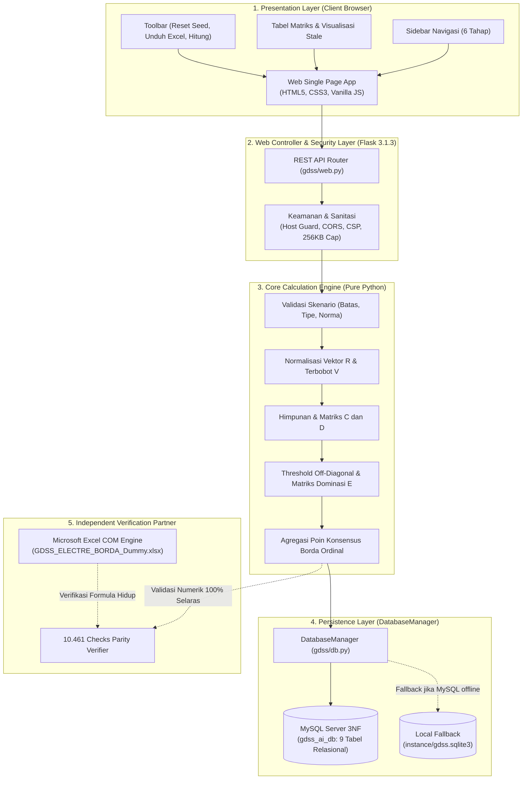
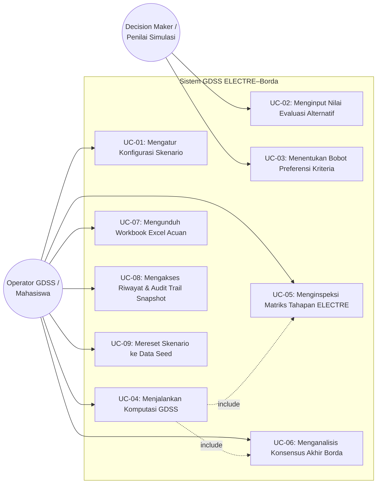
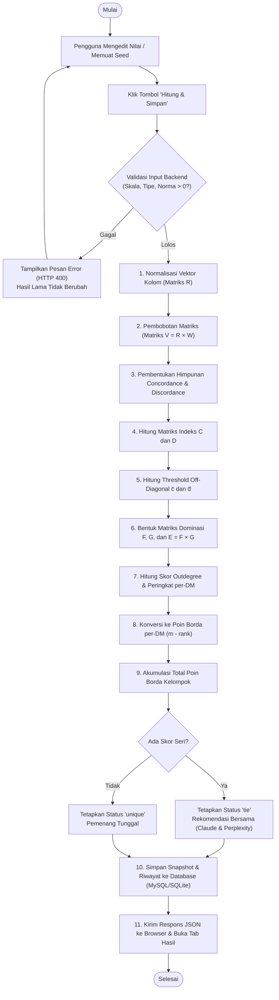
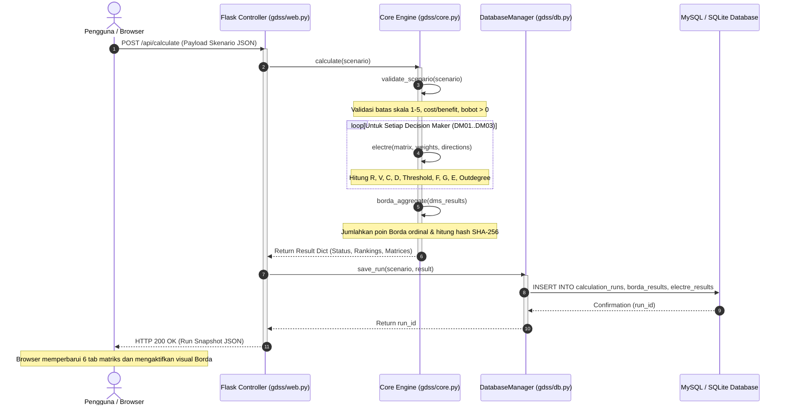
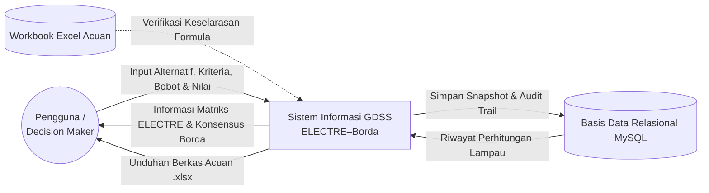
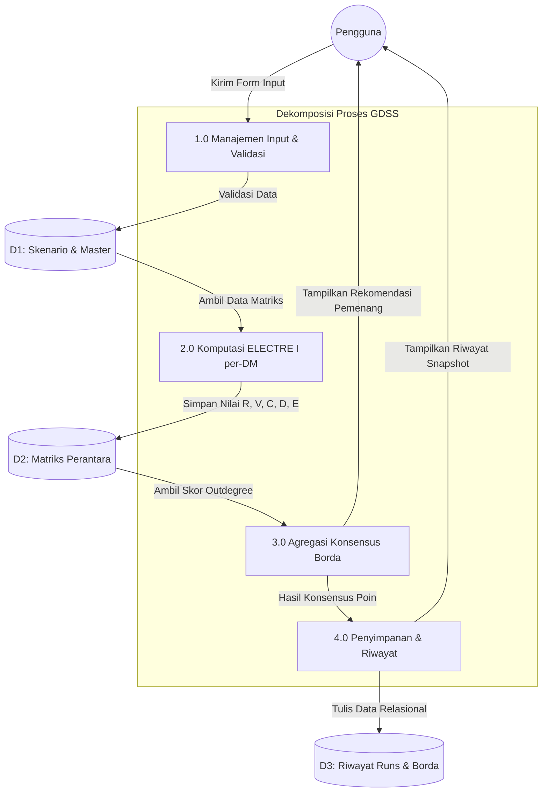

# Dokumentasi Diagram Sistem Lengkap (GDSS ELECTRE–Borda)

**Mata Kuliah:** Praktikum Sistem Informasi / GDSS  
**Judul Proyek:** Implementasi GDSS Menggunakan Metode ELECTRE dan Borda dalam Pemilihan Platform Artificial Intelligence untuk Mendukung Produktivitas Akademik Mahasiswa  
**Penanggung Jawab:** Safri Firzan Sururi (240605110084) — Ketua / Desain Sistem  
**Format Diagram:** Mermaid Standard (Didukung penuh oleh Obsidian, GitHub, dan Typora)

---

## 1. Diagram Arsitektur Sistem (System Architecture Diagram)

Diagram ini mengilustrasikan arsitektur berlapis (*layered architecture*) aplikasi, mulai dari antarmuka pengguna, pengontrol web, mesin komputasi murni, hingga lapisan penyimpanan dan validasi formula Excel.



---

## 2. Use Case Diagram

Diagram ini mendefinisikan fungsionalitas sistem yang dapat diakses oleh aktor utama (Operator GDSS / Mahasiswa dan Penilai Simulasi / Decision Makers).



---

## 3. Activity Diagram (Alur Kerja Komputasi ELECTRE–Borda)

Diagram aktivitas menggambarkan tahapan logika pemrosesan data sejak pengguna menekan tombol *"Hitung & Simpan"* hingga hasil ditampilkan dan disimpan ke basis data.



---

## 4. Sequence Diagram (Skenario Eksekusi Perhitungan)

Diagram sekuensial merinci pertukaran pesan antar-objek (*lifelines*) selama satu siklus eksekusi perhitungan.



---

## 5. Data Flow Diagram (DFD) Level 0 & Level 1

### 5.1 DFD Level 0 (Context Diagram)
Menggambarkan batasan sistem dan aliran data dengan entitas luar.



### 5.2 DFD Level 1 (Dekomposisi Proses)
Menampilkan aliran data pada modul-modul fungsional internal.



---

## 6. Diagram Deployment (Topologi Komponen Lokal)

Diagram ini menunjukkan node fisik dan komponen perangkat lunak yang berjalan di mesin komputer pengguna (arsitektur *stand-alone offline*).

```mermaid
flowchart TD
    subgraph ClientNode ["Client Environment (Peramban Web)"]
        Browser["Web Browser (Google Chrome / Microsoft Edge)"]
        HTMLApp["GDSS Single Page Application (Port 8765)"]
        Browser --> HTMLApp
    end

    subgraph HostNode ["Host Environment (Mesin Pengembang / Windows PC)"]
        subgraph PythonRuntime ["Python 3.11 Runtime Environment"]
            FlaskWSGI["WSGI Server (run.py / Flask 3.1.3)"]
            PyMySQLDriver["PyMySQL Database Driver"]
            CoreLib["Library gdss.core & openpyxl"]
        end

        subgraph DatabaseServers ["Database Services"]
            MySQLService[("MySQL Server (Port 3306 / XAMPP)") ]
            SQLiteFile[("SQLite File (instance/gdss.sqlite3)") ]
        end
    end

    HTMLApp <-->|"HTTP REST / JSON (Localhost:8765)"| FlaskWSGI
    FlaskWSGI --> CoreLib
    FlaskWSGI --> PyMySQLDriver
    PyMySQLDriver <-->|"TCP Socket (Localhost:3306)"| MySQLService
    PyMySQLDriver -.->|"Fallback File I/O"| SQLiteFile
```

---

## 7. Rangkuman Kegunaan Diagram untuk Progres

1. **Safri Firzan Sururi (Ketua / Desain):** Menggunakan **Arsitektur Sistem (1)**, **Use Case (2)**, dan **DFD (5)** untuk mempresentasikan konsep GDSS dan interaksi pengguna.
2. **Erai Bagusalim (Backend & Database):** Menggunakan **Activity Diagram (3)**, **Sequence Diagram (4)**, dan **ERD Fisik (docs/08)** untuk membuktikan kebenaran algoritma dan integritas data 3NF.
3. **Dimas Bagus Hari Murti (Frontend):** Menggunakan alur antarmuka dan **Topologi Deployment (6)** untuk menjelaskan responsivitas web dan kemandirian sistem tanpa internet.
